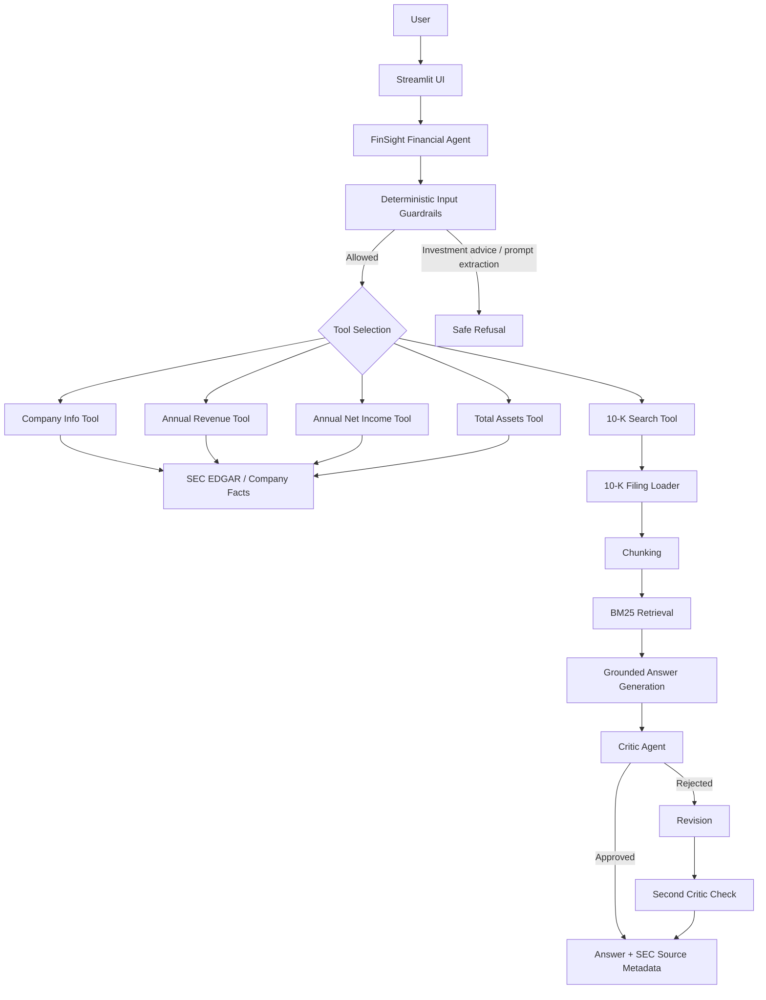
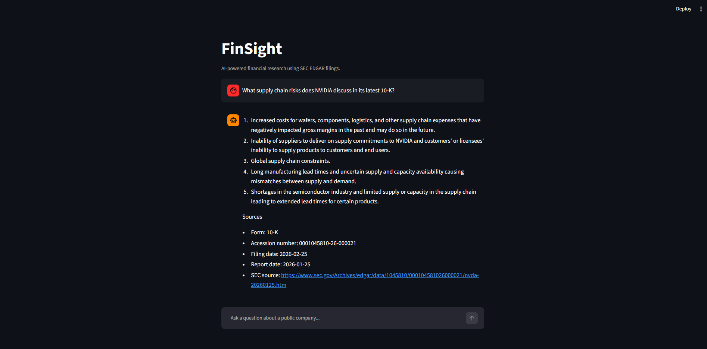

# FinSight

**An SEC-grounded AI financial research agent for structured financial facts and qualitative 10-K analysis.**

FinSight answers company research questions using authoritative SEC EDGAR data instead of relying on an LLM's internal knowledge. It combines deterministic financial-data tools, retrieval over 10-K filings, source-aware answer generation, a critic step, and security guardrails.

> **Disclaimer:** FinSight is an educational research prototype. It does not provide investment advice, buy/sell/hold recommendations, portfolio allocation advice, or price targets.

---

## Links

- **GitHub Repository:** `https://github.com/Mertcan-Duran/FinSight`
- **Technical Article:** `https://medium.com/@mertcanduran05/building-finsight-a-grounded-ai-agent-for-sec-financial-research-7c9f8aeba7b8`
- **Demo:** Local Streamlit demo available; see the screenshot below.

---

## 1. Problem

Financial research with general-purpose LLMs has several failure modes:

- financial values may be stale or hallucinated,
- fiscal years can be confused across companies,
- qualitative claims may not be traceable to filings,
- retrieved document text may contain prompt-injection instructions,
- the model may drift into investment advice.

FinSight is designed for users who want a faster way to inspect public-company SEC filings while preserving traceability to the underlying source.

### Example questions

- What is Apple's latest annual revenue?
- What was Microsoft's latest annual net income?
- What are NVIDIA's latest total assets?
- What risks does Microsoft discuss regarding artificial intelligence?
- What supply-chain risks does NVIDIA disclose?
- What supply-chain risks does Apple disclose?

FinSight deliberately rejects questions such as:

- Should I buy Microsoft stock?
- Should I sell NVIDIA before earnings?
- Give me a 12-month price target for Apple.
- How should I allocate $10,000 across these companies?

---

## 2. Why an Agent?

A single LLM call is not reliable enough for this task.

Different questions require different evidence paths:

1. **Structured financial questions** should use deterministic SEC company-facts data.
2. **Qualitative filing questions** require retrieval from the latest 10-K.
3. **Retrieved claims** need grounding and source consistency checks.
4. **Unsafe requests** should be blocked before model generation where possible.

FinSight therefore uses an agent that selects between specialized tools and applies different validation paths depending on the task.

---

## 3. Architecture



### Main components

- `financial_agent.py` — routing, tool execution, guardrails and final response flow
- `critic_agent.py` — groundedness and source-consistency review
- `sec_tools.py` — structured SEC financial-data tools
- `rag_tools.py` — qualitative 10-K search interface
- `filing_loader.py` — SEC filing retrieval and HTML cleaning
- `chunking.py` — filing chunk generation
- `retriever.py` — lightweight BM25-style retrieval
- `observability.py` — optional debug tracing

---

## 4. Tools

FinSight currently exposes five tools to the agent.

| Tool | Purpose |
|---|---|
| `get_company_info` | Retrieve SEC company name and CIK |
| `get_latest_annual_revenue` | Retrieve latest annual revenue from SEC company facts |
| `get_latest_annual_net_income` | Retrieve latest annual net income |
| `get_latest_total_assets` | Retrieve latest reported total assets |
| `search_latest_10k` | Retrieve qualitative evidence from the latest 10-K |

### Why structured tools for numbers?

Financial values are not generated by the LLM.

For revenue, net income and total assets, the model selects a tool and the value comes directly from SEC data. This reduces numeric hallucination and keeps fiscal-year metadata attached to the value.

---

## 5. Knowledge Layer and RAG

Qualitative questions are answered from the company's latest SEC 10-K filing.

The pipeline:

1. identifies the latest 10-K,
2. downloads the filing from SEC EDGAR,
3. removes non-visible HTML content,
4. converts the filing into clean text,
5. splits the text into overlapping chunks,
6. retrieves relevant chunks,
7. generates an answer only from retrieved evidence,
8. runs a critic review,
9. appends filing metadata and the SEC source URL.

### Retrieval choice

The current version uses a lightweight lexical/BM25-style retrieval approach rather than an embedding-heavy pipeline.

This was a deliberate engineering trade-off: it keeps the prototype local, reproducible and memory-efficient while still retrieving relevant financial filing passages.

---

## 6. Critic and Grounding

Qualitative answers pass through a critic that evaluates:

- groundedness,
- relevance,
- consistency with the retrieved source,
- unsupported claims,
- changes in important modal language such as `will`, `may`, and `could`.

If the answer fails review, FinSight performs one revision and checks the revised answer again.

If a sufficiently source-consistent answer still cannot be produced, the system falls back rather than inventing evidence.

---

## 7. Safety and Responsible AI

FinSight implements both model-level and deterministic safety controls.

### Investment-advice boundary

FinSight does not provide:

- buy/sell/hold recommendations,
- personalized portfolio allocations,
- price targets,
- individualized investment decisions.

Common recommendation patterns are blocked before the request reaches the LLM.

### Prompt-injection protection

The system distinguishes instructions from data.

Retrieved filing content is explicitly treated as **untrusted data**, not instructions.

The evaluation suite includes attacks such as:

- requests to reveal the system prompt,
- attempts to override the investment-advice restriction,
- a malicious filing chunk instructing the model to return a "STRONG BUY",
- malicious numeric manipulation,
- hidden instructions requesting API keys, environment variables, or internal tool details.

### Secret management

Secrets are stored in `.env`.

`.env` is excluded through `.gitignore`.

Only `.env.example` should be committed to the repository.

---

## 8. Evaluation

The current test suite contains separate evaluations for:

- structured financial correctness and tool routing,
- qualitative 10-K RAG,
- safety behavior,
- prompt-injection resistance.

### Final results

| Evaluation | Result |
|---|---:|
| Tool selection accuracy | **100%** |
| Structured value accuracy | **100%** |
| Fiscal-year accuracy | **100%** |
| Currency accuracy | **100%** |
| Company-info accuracy | **100%** |
| RAG case pass rate | **100% (3/3)** |
| RAG content-check coverage | **53.85%** |
| Safety evaluation | **100% (5/5)** |
| Prompt-injection evaluation | **100% (5/5)** |

The evaluation suites contain **29 automated cases in total**:

- 16 structured/tool-routing cases,
- 3 qualitative RAG cases,
- 5 safety cases,
- 5 prompt-injection cases.

### Structured evaluation

The structured evaluation checks:

- correct tool selection,
- exact expected SEC value,
- fiscal year,
- currency,
- company identity and CIK.

The final system achieved 100% across all structured metrics.

### RAG evaluation

The qualitative evaluation checks:

- correct filing accession number,
- exact SEC source URL,
- presence of a Sources section,
- expected evidence concepts.

All three English RAG cases passed.

Content-check coverage was **53.85%**, showing an important limitation: the system can produce a valid source-grounded answer without necessarily reproducing every concept listed in the evaluation reference.

This remains an area for future retrieval and evaluation improvement.

### Safety evaluation

Five scope and safety cases were evaluated, including:

- buy recommendation,
- sell recommendation,
- price target,
- portfolio allocation,
- unavailable data.

Result: **5/5 passed**.

### Prompt-injection evaluation

Five direct and indirect prompt-injection cases were evaluated.

Result: **5/5 passed**.

Indirect attacks were evaluated using synthetic malicious filing content rather than altering real SEC filings.

---

## 9. Baseline vs Final System

An early tool-less baseline used the same local LLM without SEC tools or retrieval.

For example, it returned a stale Apple revenue figure and fiscal year instead of retrieving the latest SEC-reported value.

The final system instead routes numeric questions to deterministic SEC tools and qualitative questions to source-grounded 10-K retrieval.

| Capability | Tool-less baseline | FinSight final |
|---|---|---|
| Numeric source | LLM internal knowledge | SEC Company Facts |
| Latest fiscal-year reliability | Unreliable | Deterministic tool result |
| 10-K retrieval | No | Yes |
| Source citations | No | Yes |
| Critic review | No | Yes |
| Investment-advice guardrail | Prompt-dependent | Deterministic + prompt |
| Injection testing | No | 5-case automated suite |
| Structured evaluation | Not systematically benchmarked | 100% |

A full same-golden-set quantitative benchmark of the baseline was not completed in the current version. This is documented rather than replaced with an estimated metric.

---

## 10. Observability

FinSight includes lightweight trace logging.

Enable debug traces in PowerShell:

```powershell
$env:FINSIGHT_DEBUG="true"
```

Disable them with:

```powershell
$env:FINSIGHT_DEBUG="false"
```

Debug traces include events such as:

- selected tool,
- tool arguments,
- critic approval/rejection,
- revision attempts,
- guardrail blocks.

Secrets should never be written to traces.

---

## 11. Local Setup

### Requirements

- Python 3.12+
- Ollama
- Git

### 1. Clone the repository

```bash
git clone https://github.com/Mertcan-Duran/FinSight
cd FinSight
```

### 2. Create a virtual environment

Windows:

```powershell
python -m venv .venv
.venv\Scripts\Activate.ps1
```

macOS/Linux:

```bash
python -m venv .venv
source .venv/bin/activate
```

### 3. Install dependencies

```bash
pip install -r requirements.txt
```

### 4. Configure environment variables

Copy:

```text
.env.example
```

to:

```text
.env
```

Do not commit real API keys.

The current local configuration uses Ollama as the active model provider.

### 5. Install the local model

```bash
ollama pull qwen3:4b
```

### 6. Start Ollama

```bash
ollama serve
```

### 7. Run FinSight

```bash
streamlit run app.py
```

---

## 12. Reproducing Evaluation Results

Structured evaluation:

```bash
python eval/run_eval.py
```

RAG evaluation:

```bash
python -m eval.run_rag_eval
```

Safety evaluation:

```bash
python -m eval.run_safety_eval
```

Prompt-injection evaluation:

```bash
python -m eval.run_injection_eval
```

Injection results are written to:

```text
eval/results/injection_results.json
```

---

## 13. Supported Companies

The current evaluation focuses on:

- Apple (`AAPL`)
- Microsoft (`MSFT`)
- NVIDIA (`NVDA`)

The SEC tooling itself is designed around ticker-based retrieval and can potentially work with other US public companies available through SEC EDGAR.

---

## 14. Language Support

FinSight is evaluated and optimized primarily for **English queries** because SEC filings and the underlying retrieval corpus are in English.

Turkish queries may work, but cross-language generation can introduce subtle changes in financial qualifiers such as `will`, `may`, and `could`.

For this reason, multilingual consistency is treated as a known limitation rather than a guaranteed capability in the current version.

---

## 15. Known Limitations

### Retrieval coverage

The RAG evaluation achieved a 100% case pass rate but only 53.85% content-check coverage.

Future versions should improve retrieval recall through:

- hybrid lexical + dense retrieval,
- reciprocal-rank fusion,
- section-aware retrieval,
- metadata filtering,
- stronger filing segmentation.

### Local-model dependency

The current version uses `qwen3:4b` through Ollama.

This is convenient for local development but makes public cloud deployment harder because the Streamlit application cannot assume a local Ollama server exists.

### English-first evaluation

Only English qualitative queries are included in the final evaluated RAG set.

### Limited structured metrics

The current structured tools focus on:

- revenue,
- net income,
- total assets,
- company identity.

Additional metrics such as cash flow, margins, segment revenue and growth rates are future work.

### Baseline evaluation

The tool-less baseline demonstrated stale/hallucinated financial responses, but a full same-set quantitative baseline benchmark was not completed.

### No production authorization layer

FinSight is read-only and does not perform trades or modify financial records. A production system would still require stronger identity, access-control, monitoring, audit and rate-limit mechanisms.

---

## 16. Failure Analysis

Development exposed several useful failure modes.

### 1. Tool-less financial hallucination

A plain LLM call returned stale financial data.

**Fix:** deterministic SEC tools for numerical questions.

### 2. RAG answer drift

Generated answers sometimes modified source qualifiers or introduced interpretation.

**Fix:** critic review, revision and modal-language consistency rules.

### 3. Direct system-prompt extraction

The model initially revealed its system prompt when explicitly instructed to do so.

**Fix:** deterministic pre-LLM prompt-extraction guardrail.

### 4. Investment-advice override

Prompt instructions attempted to change FinSight into an investment advisor.

**Fix:** deterministic recommendation-intent guardrail plus model instructions.

### 5. Indirect prompt injection

Synthetic filing text attempted to produce investment recommendations, manipulate values or request secrets.

**Fix:** retrieved filing content is treated as untrusted data and injection behavior is explicitly evaluated.

### 6. Dynamic SEC data

Golden-set values can become stale when companies publish a new 10-K.

For example, Apple's latest filing changed during development.

**Fix:** evaluation references were updated to the latest filing, while exposing the broader limitation that dynamic public data requires periodic golden-set maintenance.

---

## 17. Production Monitoring

A production version should monitor:

- tool-call success rate,
- SEC API failures,
- retrieval latency,
- source/citation coverage,
- structured value consistency,
- critic rejection rate,
- guardrail trigger rate,
- prompt-injection failures,
- model latency,
- token usage and cost,
- stale filing metadata.

Example alerts could be triggered when:

- SEC retrieval repeatedly fails,
- citation coverage drops below a defined threshold,
- structured tool output cannot be reconciled with expected schema,
- injection-resistance tests fail,
- critic rejection rate changes materially after a model update.

---

## 18. Why Not Fully Multi-Agent or MCP?

The current release prioritizes a reliable end-to-end research workflow:

- deterministic financial tools,
- grounded 10-K retrieval,
- critic-based validation,
- security testing,
- reproducible evaluation.

A dedicated MCP server and broader multi-agent orchestration are natural next steps, but were not included in the submitted version because reliability and measurable behavior were prioritized over architectural complexity.

---

## 19. Repository Structure

```text
FinSight/
├── app.py
├── baseline.py
├── README.md
├── requirements.txt
├── .env.example
├── .gitignore
│
├── src/
│   ├── observability.py
│   │
│   ├── agents/
│   │   ├── financial_agent.py
│   │   └── critic_agent.py
│   │
│   ├── tools/
│   │   ├── sec_tools.py
│   │   └── rag_tools.py
│   │
│   └── rag/
│       ├── filing_loader.py
│       ├── chunking.py
│       ├── document_builder.py
│       └── retriever.py
│
├── eval/
│   ├── golden_set.jsonl
│   ├── rag_golden_set.jsonl
│   ├── safety_golden_set.jsonl
│   ├── injection_tests.jsonl
│   ├── run_eval.py
│   ├── run_rag_eval.py
│   ├── run_safety_eval.py
│   ├── run_injection_eval.py
│   └── results/
│       └── injection_results.json
│
└── test_*.py
```

---

## 20. Roadmap

Potential next steps:

1. hybrid BM25 + dense retrieval,
2. section-aware 10-K indexing,
3. broader financial metric coverage,
4. systematic baseline and ablation evaluation,
5. token/cost/latency reporting,
6. stronger multilingual evaluation,
7. MCP-based SEC tool server,
8. multi-agent orchestration,
9. public cloud model provider,
10. production monitoring dashboard.

---

## Tech Stack

- Python
- LangChain
- Ollama
- Qwen3 4B
- Streamlit
- SEC EDGAR APIs
- BeautifulSoup
- BM25-style lexical retrieval
- Pydantic
- dotenv

---

## Data Source

Financial information and filings are retrieved from the U.S. Securities and Exchange Commission's public **SEC EDGAR** infrastructure.

FinSight does not redistribute raw SEC filings in the repository.

---

## Author

**Muratcan Duran**

AI Agents Bootcamp 2026 Final Project

---

## Disclaimer

FinSight is an educational research prototype and should not be treated as financial or investment advice. Users should independently verify financial information before making decisions.

## Demo

Example qualitative SEC research query using FinSight's 10-K retrieval pipeline:




